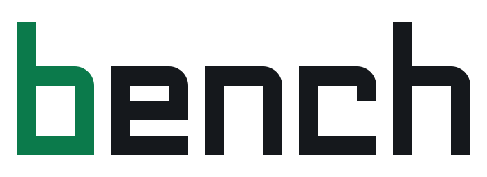

<p align="center">
  <picture>
    <source media="(prefers-color-scheme: dark)" srcset="assets/brand/bench-horizontal-dark.svg">
    
  </picture>
</p>

<p align="center"><strong>Validation first. Every result measured twice.</strong></p>

<p align="center"><a href="https://github.com/STACK-42/bench/actions/workflows/ci.yml"></a></p>

bench is a Claude Code plugin for machine learning competitions on Kaggle and Zindi. Its goal is the best final score. First it builds a validation you can trust. Then a main agent and research agents run many experiments, and every one is measured the same way.


## What is in it

| part | what it does |
| --- | --- |
| `template/` | the project harness each competition starts from: `comp.toml`, data loading, CV, a shadow test, the metric, MLflow tracking (with out-of-fold predictions), a submissions log tied to commits, an `ideas.md` backlog, and Kaggle/Zindi upload |
| `skills/comp-start` | set up a new competition and build and prove the validation before any model |
| `skills/experiment` | one idea, scored on CV and the shadow test against the noise, logged, kept or dropped |
| `skills/research` | send research agents to try many ideas in their own worktrees, with a fixed brief and report |
| `skills/submit` | plan the day's few uploads, upload with your approval, pick the final submissions |
| `skills/review` | after each leaderboard score: do the checks agree? Record lessons |
| `skills/blend` | combine experiments that differ in method, with weights chosen on out-of-fold predictions |
| `skills/explain` | optional learning notes in three layers, in simple English |
| `agents/scouter` | reads the web (forums, winning write-ups, papers, books) and writes idea cards to `ideas.md`; runs no code |
| `agents/researcher` | tests the cards of one direction in a git worktree and reports a table; no web access |
| `agents/validator` | checks the data and the validation: adversarial validation, train/test distance, whether the checks agree, noise, simple baselines |
| `agents/leak-auditor` | reads an experiment and reports any information leak |
| `hooks/guard.py` | in competition repos: asks you before every upload, blocks uploads that skip the log, blocks whole-folder formatting |
| `lessons/seed.md` | lessons across competitions, read at the start of each new one |
| `assets/brand/` | the bench logo kit (symbol, wordmark, lockups, icons), the workflow and agent diagrams, `notes.css` for themed learning notes, and `GUIDELINES.md` |

## Install

```text
/plugin marketplace add STACK-42/bench
/plugin install bench@bench
```

> [!NOTE]
> If you have no SSH key for GitHub, set `CLAUDE_CODE_PLUGIN_PREFER_HTTPS=1` before starting Claude Code, so the install uses HTTPS.

## Use

Start a competition by telling Claude, or run the skill directly:

```text
/bench:comp-start https://www.kaggle.com/competitions/<name>
```

For a competition repo that already has its own harness, `/bench:comp-start` adds a `comp.toml` that names the repo's own commands instead of copying the template.

Then work in that repo:

```text
/bench:experiment   try adding lag features to 003_baseline
/bench:research     test the ideas in this playbook against our best model
/bench:submit       upload the best file when the limit resets
/bench:review       the score came back: 0.912
/bench:blend        blend 007 and 012
```

Every experiment is scored twice. `uv run comp run` gives the CV score and the shadow score, and `uv run comp compare` keeps a change only if it is better on both by more than twice the noise that `uv run comp noise` measured. The leaderboard is a third check and never decides alone.

`comp.toml` in each competition repo sets solo or team mode (team mode adds per-person experiment folders and reviewers) and whether learning notes are written.

## Agents

The main agent does the work in your repo. For jobs that need a clean room, it sends one of four agents, each with one job and fixed limits.

![The bench agents. The main agent owns the repo, picks the directions, writes the briefs and rebuilds the winners itself, and you approve every upload. The scouter reads forums, write-ups, papers and books and returns cards in ideas.md; it can use the web but can't run code. Up to three researchers each test one direction's cards in their own git worktree and return a report table; they run code but have no web. The validator reads the data, CV, shadow and leaderboard scores and returns the noise, the train/test gap and whether the checks agree; it runs code, no web. The leak auditor reads a winner's code before any upload and returns clean or each leak with file and line; it is read-only. The rule: an agent that reads the web can't run code, and one that runs code can't read the web.](assets/brand/agents.svg)

`/bench:research` runs them as a round. The ideas live as cards in `ideas.md`, and every tested card goes back with its numbers, so nobody repeats a dropped idea.

![A research round in five steps: 1 fill, the scouter writes cards and the validator checks the validation; 2 choose three to six directions with one brief each; 3 test, up to three researchers each in a worktree; 4 audit, the leak auditor reads each winner's code; 5 rebuild, the main agent builds the winners as the next experiment. Results go back on the card in ideas.md, which moves from new to testing to kept or dropped. A winner is kept only if CV and the shadow test both beat twice the noise and the report's first row reproduces the baseline's scores exactly; the main agent reruns it before any upload.](assets/brand/research-round.svg)

## How it is built

- Claude runs the work. The skills say what to do at each stage, and each agent has one job and fixed limits. The agent that reads the web (scouter) can't run code, and the agents that run code (researcher, validator) can't read the web, so text on a web page can never become a command. The hook enforces two rules that should never depend on an agent remembering them: uploads need your approval, and nothing formats the whole folder.
- The template is copied into each competition and then belongs to it. Change `data.py`, `cv.py`, `metric.py` and `shadow.py` freely for a competition with a different shape; keep their meaning.
- Lessons live in `~/.bench/lessons.md` on your machine, seeded from `lessons/seed.md`. Add the general ones back to `lessons/seed.md` here so every new competition starts from them.

## Develop

```bash
cd template && uv sync && uv run pytest && cd ..
uv run --project template pytest tests     # the hook's tests
claude plugin validate .
```
